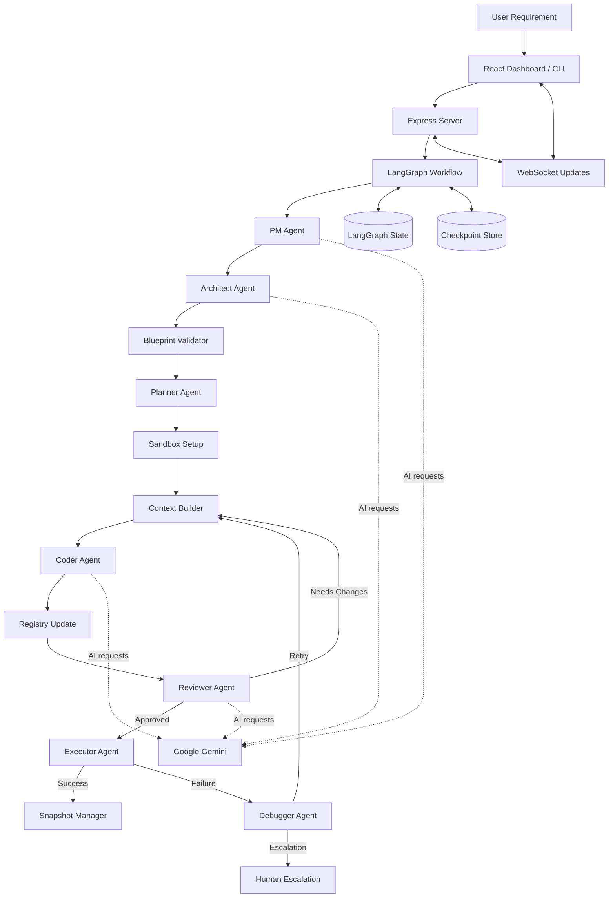

<div align="center">

# 🤖 AI Dev Team

### AI-Powered Multi-Agent Software Development System

**From idea to implementation — plan, build, review, test, debug, and deploy with AI agents.**


</div>

---

## 📖 Overview

**AI Dev Team** is an AI-powered, multi-agent software development system designed to turn a natural-language software requirement into a structured, executable project workflow.

Instead of relying on a single AI response, the system coordinates specialized agents through a **LangGraph workflow**. Agents handle requirement clarification, architecture design, blueprint validation, task planning, coding, code review, execution, debugging, feedback, and deployment preparation.

The backend uses **Google Gemini** for AI-powered tasks, while the React dashboard communicates with the server through REST APIs and WebSockets to provide project visibility and real-time updates.

---

## 📸 Screenshots

<table>
  <tr>
    <td width="50%" align="center">
      <strong>Mission Control Dashboard</strong><br/><br/>
      
    </td>
    <td width="50%" align="center">
      <strong>Project Creation</strong><br/><br/>
      
    </td>
  </tr>
  <tr>
    <td width="50%" align="center">
      <strong>Agent Workflow</strong><br/><br/>
      
    </td>
    <td width="50%" align="center">
      <strong>Execution &amp; Logs</strong><br/><br/>
      
    </td>
  </tr>
  <tr>
    <td width="50%" align="center">
      <strong>Code Review</strong><br/><br/>
      
    </td>
    <td width="50%" align="center">
      <strong>Project Results</strong><br/><br/>
      
    </td>
  </tr>
</table>

---

## ✨ Key Features

| Feature | Description |
|---|---|
| 🧠 **Requirement Analysis** | The PM Agent interprets natural-language requirements and identifies missing information. |
| 💬 **Human Clarification** | Asks follow-up questions when a requirement is ambiguous. |
| 🏗️ **Architecture Design** | Generates application blueprints, database schemas, APIs, frontend pages, and folder structures. |
| ✅ **Blueprint Validation** | Validates the generated architecture before implementation. |
| 📋 **Task Planning** | Breaks projects into phases and smaller development tasks. |
| 📦 **Sandbox Setup** | Prepares an isolated project environment. |
| 💻 **AI Code Generation** | Generates and updates project files using task-specific context. |
| 🔍 **Code Review** | Reviews generated code and routes changes for approval or revision. |
| ⚡ **Code Execution** | Executes implementation tasks and captures results. |
| 🐛 **Automated Debugging** | Analyzes execution failures and routes fixes through the workflow. |
| 🔄 **Feedback Loop** | Supports iterative refinement based on user feedback. |
| 🚀 **Deployment Preparation** | Includes deployment configuration and verification workflow state. |
| 📊 **Token Tracking** | Tracks Gemini API calls, token usage, and estimated costs. |
| 🖥️ **Web Dashboard** | React dashboard with Express APIs and WebSocket communication. |
| 💾 **Checkpointing** | Preserves workflow state and supports project resumption. |

---

## 🏗️ System Architecture

The application uses a client-server architecture. The React dashboard communicates with the Express server through REST endpoints and WebSockets. The server runs the LangGraph-based agent workflow, while Gemini powers AI tasks.



---

## 🛠️ Tech Stack

<div align="center">

### Backend & AI


### Frontend


### Communication & Persistence


</div>

---

## ⚙️ Getting Started

### Prerequisites

- **Node.js 18 or later**
- **npm**
- **Google Gemini API key** — [Get an API key](https://aistudio.google.com/apikey)
- **Redis** for Redis-backed checkpoint persistence, if enabled
- **Docker** if using the Docker-based sandbox workflow

### 1. Clone the repository

```bash
git clone <your-repository-url>
cd AIDevFinal
```

### 2. Install backend dependencies

```bash
npm install
```

### 3. Configure environment variables

Create a `.env` file in the project root:

```env
GEMINI_API_KEY=your_gemini_api_key
GEMINI_MODEL=gemini-2.5-flash
SERVER_PORT=3000
FRONTEND_URL=http://localhost:5173
```

Never commit your `.env` file or expose API keys.

### 4. Install frontend dependencies

```bash
cd dashboard
npm install
cd ..
```

### 5. Start the application

```bash
npm run dev
```

Default development addresses:

- **Dashboard:** `http://localhost:5173`
- **Backend API:** `http://localhost:3000/api`
- **WebSocket:** `ws://localhost:3000/ws`
- **Health Check:** `http://localhost:3000/api/health`

You can also start services separately:

```bash
# Terminal 1 — Backend
npm run server

# Terminal 2 — Frontend
npm run dashboard
```

---

## 🧪 Testing

Run the relevant tests from the project root:

```bash
npm run test:graph
npm run test:pm
npm run test:architect
npm run test:validator
npm run test:planner
npm run test:sandbox
npm run test:devloop
npm run test:all:mock
```

Tests requiring Gemini or external services may need API keys and services configured.

---

## 📂 Project Structure

```text
AIDevFinal/
├── dashboard/
│   ├── src/
│   │   ├── App.jsx
│   │   ├── index.css
│   │   └── main.jsx
│   ├── index.html
│   ├── package.json
│   └── vite.config.js
│
├── server/
│   ├── routes/
│   │   └── projects.js
│   ├── services/
│   │   └── graphRunner.js
│   ├── ws/
│   │   └── handler.js
│   └── index.js
│
├── src/
│   ├── agents/
│   │   ├── architectAgent.js
│   │   ├── blueprintValidator.js
│   │   ├── coderAgent.js
│   │   ├── debuggerAgent.js
│   │   ├── executorAgent.js
│   │   ├── plannerAgent.js
│   │   ├── pmAgent.js
│   │   └── reviewerAgent.js
│   ├── config/
│   │   ├── graph.js
│   │   └── state.js
│   ├── nodes/
│   │   ├── contextBuilder.js
│   │   ├── humanInput.js
│   │   ├── humanEscalation.js
│   │   ├── setupSandbox.js
│   │   ├── snapshotManager.js
│   │   └── ...
│   ├── utils/
│   │   ├── gemini.js
│   │   ├── redisDocker.js
│   │   ├── sandboxManager.js
│   │   └── tokenTracker.js
│   └── index.js
│
├── tests/
├── .env.example
├── package.json
└── README.md
```

---

## 🔄 How the Multi-Agent Workflow Works

1. **Requirement Intake:** The user provides a software idea through the CLI or dashboard.
2. **Clarification:** The PM Agent asks questions and prepares a clear specification.
3. **Architecture:** The Architect Agent creates a technical blueprint.
4. **Validation:** The Blueprint Validator checks the architecture.
5. **Planning:** The Planner Agent converts the blueprint into actionable tasks.
6. **Environment Setup:** The sandbox workflow prepares the project environment.
7. **Implementation:** The Context Builder prepares context for the Coder Agent.
8. **Review:** The Reviewer Agent evaluates generated changes.
9. **Execution:** Approved changes proceed to execution.
10. **Debugging:** Failed executions are routed to the Debugger Agent.
11. **Iteration:** The workflow tracks feedback, snapshots, and deployment verification.

---

## 🔐 Environment & Security

- Keep API keys and credentials in environment variables.
- Never commit `.env` files, tokens, or generated secrets.
- Configure CORS with the correct dashboard origin.
- Use appropriate isolation when executing generated code.
- Review generated code and deployment settings before production use.

---

<div align="center">

### 🚀 AI Dev Team

**Turning software ideas into structured, AI-assisted development workflows.**

</div>
